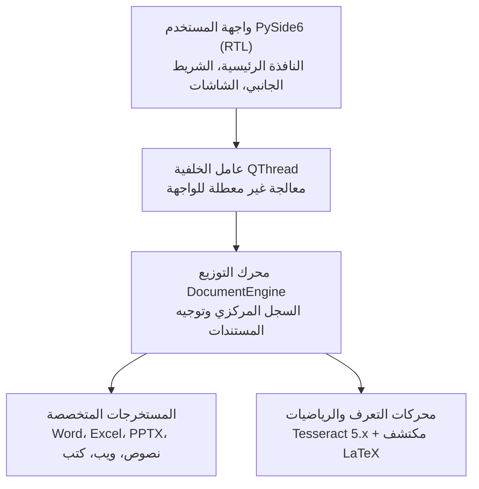

<div dir="rtl">

<div align="center">


# نَصّ | NASS
### تطبيق سطح مكتب ذكي لاستخراج النصوص والتعرف الضوئي (OCR) محلياً
**«حيث تتحول الصور إلى كلمات.»**

[](https://opensource.org/licenses/MIT)
[](https://www.python.org/)
[](https://www.qt.io/)
[](https://github.com/tesseract-ocr/tesseract)
[](tests/)
[](docs/ARCHITECTURE.md)

[**English README**](README.md) • [**المعمارية البرمجية**](docs/ARCHITECTURE.md) • [**الصيغ المدعومة**](docs/SUPPORTED_FORMATS.md) • [**دليل التثبيت**](docs/INSTALLATION.md) • [**المساهمة والتطوير**](CONTRIBUTING.md)

</div>

---

## 🌟 نظرة عامة

**نَصّ (NASS)** هو تطبيق حاسوبي متقدم ومفتوح المصدر مبني بلغة بايثون وواجهة PySide6 (Qt) لاستخراج النصوص والتعرف الضوئي على المحارف (OCR) من مختلف أنواع المستندات، ملفات PDF، الصور، جداول البيانات، والعروض التقديمية، مع دعم أصيل واستثنائي للغة العربية والمعادلات الرياضية.

يرتكز نَصّ على مبدأين أساسيين:
1. **معالجة محلية وخاصة بنسبة 100%:** تتم جميع عمليات المعالجة واستخراج النصوص داخل حاسوبك الشخصي دون الحاجة لأي اتصال بالإنترنت، ودون إرسال أي صورة أو وثيقة إلى أي خادم خارجي أو طرف ثالث.
2. **استخراج النصوص الرقمية الأصلية أولاً (Native-First):** يقوم التطبيق بقراءة النصوص المدمجة رقمياً في المستندات مباشرة وبدقة تامة 100% وبسرعة فائقة، ويلجأ إلى محرك OCR فقط عند غياب النصوص الرقمية أو عند معالجة الصور والمستندات الممسوحة ضوئياً.

---

## ✨ المميزات الرئيسية

- **دعم استخراج النصوص من طيف واسع من صيغ الملفات:**
  - 🖼️ **الصور الرقمية:** دعم كامل لصيغ `PNG` و `JPG` و `JPEG` و `WEBP` و `BMP` و `TIFF` عبر Tesseract مع فلاتر معالجة متقدمة.
  - 📄 **مستندات PDF:** معالجة هجينة ذكية تقرأ النصوص الرقمية الأصلية صفحة بصفحة، وتحول الصفحات الممسوحة ضوئياً إلى صور عالية الدقة لتطبيق OCR عليها.
  - 📝 **مستندات مايكروسوفت وورد (Word):** استخراج نصوص ملفات `DOCX` بدقة متناهية مع قراءة الجداول والفقرات.
  - 📊 **جداول البيانات (Excel & CSV):** استخراج محتوى الجداول من ملفات `XLSX` و `XLS` و `CSV` مع دعم الصفحات المتعددة والحفاظ على ترتيب الحقول.
  - 📽️ **العروض التقديمية (PowerPoint):** استخراج النصوص من شرائح `PPTX` ومربعات النصوص وملاحظات العرض.
  - 📑 **الملفات النصية:** قراءة ملفات `TXT` و `MD` (ماركداون) مع كشف تلقائي للترميز (UTF-8 و Arabic CP1256)، وتجريد نصوص `RTF` من وسوم التنسيق.
  - 🌐 **ملفات الويب والترميز:** استخراج النصوص المقروءة من ملفات `HTML` و `XML` مع استبعاد وسوم السكربتات والتنسيقات.
  - 🗄️ **البيانات المهيكلة والكتب:** استخراج منظم لملفات `JSON`، واستخراج محتوى المستندات المفتوحة `ODT` وكتب `EPUB` الإلكترونية.
- **استخراج المعادلات والصيغ الرياضية (LaTeX):**
  - مكتشف رياضي ذكي يحول الكسور، الجذور، الأسس، الرموز الإغريقية، والمتطابقات إلى صيغ LaTeX القياسية (`$$...$$`).
- **إدارة احترافية لمحرك Tesseract واللغات:**
  - اكتشاف تلقائي لمسار تثبيت Tesseract على أنظمة Windows و Unix.
  - كتالوج مدمج لتصفح وتنزيل حزم اللغات الرسمية (`tessdata_fast`) في الخلفية مع شريط تقدم وفحص سلامة الملفات.
  - إمكانية اختيار أكثر من لغة في الوقت نفسه لمعالجة الملفات ثنائية اللغة (`ara+eng`).
- **خيارات تعرف وفلاتر معالجة متقدمة للصور:**
  - تحويل لتدرج الرمادي (Grayscale)، عتبة ثنائية (Thresholding)، تحسين التباين، إزالة الضوضاء، وتعديل الميلان (Deskewing).
  - التحكم في وضع تجزئة الصفحة (PSM) ونمط محرك التعرف (OEM).
- **تصدير مرن للنتائج:**
  - ملف نصي نقي (`.txt`) بترميز UTF-8 مع خيارات فواصل الصفحات.
  - مستند مايكروسوفت وورد (`.docx`) بتنسيق أنيق ومحاذاة عربية من اليمين إلى اليسار (RTL).
  - ملف رياضي (`.tex`) جاهز للتضمين والتصيير عبر محركات LaTeX.
- **تصميم بصري احترافي وتجربة مستخدم متميزة:**
  - تصميم موحد بألوان كحلية وأزرق ملكي مع لمسات بنفسجية هادئة.
  - عبارات مساعدة عربية ودودة تعبر عن كل حالة معالجة (بدء، قراءة، نجاح، ملفات فارغة).
  - شريط تنقل جانبي أيمن متجاوب وسريع.

---

## 📂 جدول الصيغ المدعومة

| نوع المستند | الامتدادات المدعومة | طريقة الاستخراج المعتمدة |
|---|---|---|
| **الصور** | `.png`, `.jpg`, `.jpeg`, `.webp`, `.bmp`, `.tiff` | التعرف الضوئي OCR عبر Tesseract مع فلاتر التحسين |
| **PDF** | `.pdf` | معالجة هجينة (نص رقمي مباشر أولاً، ثم OCR للصفحات المصورة) |
| **Word** | `.docx` | استخراج رقمي أصيل للفقرات والجداول |
| **Excel & CSV** | `.xlsx`, `.xls`, `.csv` | استخراج رقمي أصيل لجميع أوراق العمل والخلايا |
| **PowerPoint** | `.pptx` | استخراج رقمي أصيل لمحتوى الشرائح والعناوين |
| **النصوص** | `.txt`, `.md`, `.rtf` | قراءة نصية مباشرة مع كشف الترميز وتجريد وسوم RTF |
| **الويب** | `.html`, `.htm`, `.xml` | استخراج رقمي مع تنظيف الأكواد والوسوم البرمجية |
| **البيانات** | `.json` | استخراج رقمي مهيكل للمفاتيح والقيم |
| **المستندات المفتوحة والكتب** | `.odt`, `.ods`, `.odp`, `.epub` | استخراج أصيل عبر قراءة الحزم وأرشيف الفصول |

*للتفاصيل التقنية الكاملة، راجع [docs/SUPPORTED_FORMATS.md](docs/SUPPORTED_FORMATS.md).*

---

## 🚀 البدء السريع والتثبيت

### 1. المتطلبات الأساسية
- بايثون 3.11 أو أحدث (يوصى بـ Python 3.12).
- محرك Tesseract OCR 5.x مثبت على جهازك ([رابط مثبت Windows الرسمي عبر UB-Mannheim](https://github.com/UB-Mannheim/tesseract/wiki)).

### 2. التثبيت والتشغيل
```bash
# استنساخ المستودع
git clone https://github.com/IbrahimSalha25/NASS.git
cd NASS

# إنشاء بيئة افتراضية وتفعيلها
python -m venv .venv
.\.venv\Scripts\activate   # على أنظمة ويندوز
# source .venv/bin/activate  # على أنظمة لينكس وماك

# تثبيت المكتبات المطلوبة
pip install -r requirements.txt
```

### 3. تشغيل التطبيق
```bash
python main.py
```

*للحصول على تعليمات التثبيت التفصيلية لأنظمة Linux و macOS، راجع [docs/INSTALLATION.md](docs/INSTALLATION.md).*

---

## 🧪 الاختبارات الآلية والجودة

يحتوي المشروع على جناح اختبارات آلي شامل يغطي جميع المعالجات، سيناريوهات OCR، إدارة اللغات، وحفظ الإعدادات:

```bash
pytest tests
```
*نتيجة الاختبارات الحالية: **55 اختباراً ناجحاً بنسبة 100% في حوالي 12 ثانية**.*

---

## 🏛️ البنية المعمارية للنظام



*للاطلاع على التوثيق المعماري الكامل ومخططات التسلسل، راجع [docs/ARCHITECTURE.md](docs/ARCHITECTURE.md).*

---

## 👨‍💻 بطاقة المطور والمعلومات

تم تصميم وتطوير تطبيق **نَصّ | NASS** بواسطة:

- **إبراهيم صالحة | Ibrahim Salha**
- طالب هندسة أنظمة ذكية وحاسوب.
- مهتم بالذكاء الاصطناعي، رؤية الحاسوب (Computer Vision)، هندسة البرمجيات النظيفة، وبناء أدوات مفتوحة المصدر تثري المحتوى والتقنية العربية.
- **حساب GitHub:** [@IbrahimSalha25](https://github.com/IbrahimSalha25)
- **البريد الإلكتروني:** [ibrahim.salha19@gmail.com](mailto:ibrahim.salha19@gmail.com)

---

## 📄 الترخيص (License)

تطبيق **نَصّ** هو مشروع برمجيات حرة ومفتوحة المصدر مرخص تحت رخصة **[MIT License](LICENSE)**.
حقوق النشر © 2026 إبراهيم صالحة. جميع الحقوق محفوظة.

</div>
