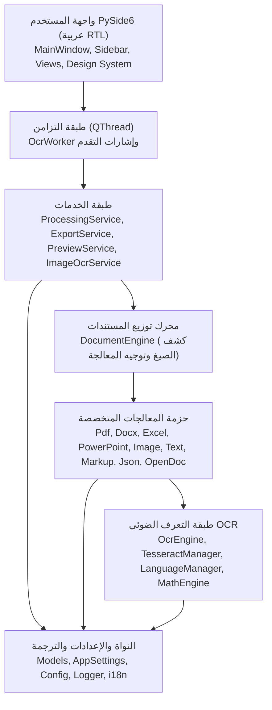

**العربية** | [English](README.md)

---

<div dir="rtl">

<div align="center">


# نَصّ | NASS
### تطبيق سطح مكتب ذكي لاستخراج النصوص والتعرف الضوئي على المحارف محلياً
**«حيث تتحول الصور إلى كلمات.»** *(Where images become words.)*

[](LICENSE)
[](https://www.python.org/)
[-0A1931.svg)](https://www.qt.io/)
[](https://github.com/tesseract-ocr/tesseract)
[](tests/)
[](docs/ARCHITECTURE.md)

[**English (الإنجليزية)**](README.md) • [**المعمارية التقنية**](docs/ARCHITECTURE.md) • [**الصيغ المدعومة**](docs/SUPPORTED_FORMATS.md) • [**دليل التثبيت**](docs/INSTALLATION.md) • [**المساهمة**](CONTRIBUTING.md)

</div>

---

## 1. نظرة عامة

**نَصّ (NASS)** هو تطبيق سطح مكتب متكامل واحترافي لاستخراج النصوص من المستندات والصور وإجراء التعرف الضوئي على المحارف (OCR) بدقة عالية. تم بناء التطبيق باستخدام Python 3.12 ومكتبة PySide6 (Qt 6) ومحرك Tesseract OCR، مع واجهة مستخدم عربية أصيلة بنظام RTL وتصميم عصري مستمد من ألوان الهوية البصرية للتطبيق.

يعتمد التطبيق على مبدأين أساسيين:
1. **الخصوصية التامة والعمل محلياً 100%:** تتم جميع عمليات المعالجة واستخراج النصوص والتعرف الضوئي محلياً على جهاز المستخدم دون إرسال أي ملفات أو نصوص إلى خوادم خارجية أو واجهات سحابية.
2. **أولوية الاستخراج المباشر للنصوص الرقمية:** في المستندات الإلكترونية (PDF و Word و Excel و PowerPoint وغيرها)، يستخرج التطبيق النصوص الرقمية المضمنة مباشرة وبدقة فائقة وسرعة عالية، مع تشغيل محرك OCR فقط للصفحات الممسوحة ضوئياً أو الصور المضمنة.

---

## 2. أبرز الميزات

- **دعم شامل لصيغ المستندات:**
  - **الصور:** دعم صيغ PNG و JPG و JPEG و WEBP و BMP و TIFF بمرشحات معالجة ذكية.
  - **مستندات PDF:** معالجة هجينة ذكية تجمع بين الاستخراج المباشر للنصوص وتصيير الصفحات الممسوحة ضوئياً للتعرف عليها عبر OCR.
  - **حزمة مايكروسوفت أوفيس:** استخراج النصوص والجداول من ملفات Word (`.docx`) وجداول Excel (`.xlsx`, `.xls`, `.csv`) وعروض PowerPoint (`.pptx`).
  - **استخراج النصوص من الصور المضمنة:** فحص المستندات واستخراج النصوص الموجودة داخل الصور المضمنة في ملفات Word و Excel و PowerPoint و PDF تلقائياً عبر OCR.
  - **الملفات النصية وصفحات الويب:** دعم `.txt` و `.md` و `.rtf` مع كشف الترميز، إضافة لملفات الويب `.html` و `.xml` وتصفية وسوم البرمجة والتنسيق.
  - **البيانات المهيكلة والمستندات المفتوحة:** دعم ملفات `.json` بصيغة مهيكلة، ومستندات OpenDocument (`.odt`, `.ods`, `.odp`) والكتب الإلكترونية (`.epub`).
- **المعالجة الدفعية للمجلدات:**
  - إمكانية معالجة مجلدات كاملة فرعياً مع استعراض تقدم العملية وحفظ النتائج وتصدير ملخص دفعة الملفات إلى تقرير CSV.
- **معاينة تفاعلية متعددة الصفحات:**
  - معاينة بصرية حية لصفحات المستندات مع أدوات تكبير وتصغير وملاءمة العرض والتنقل السلس بين الصفحات.
- **استخراج المعادلات الرياضية (LaTeX):**
  - كاشف رياضي مدمج يتعرف على الكسور والجذور والرموز اليونانية ويحولها إلى صيغة LaTeX القياسية (`$$...$$`).
- **إدارة محرك Tesseract وحزم اللغات:**
  - كشف تلقائي لمسارات التثبيت على مختلف أنظمة التشغيل (Windows, Linux, macOS).
  - متجر داخلي لتصفح وبحث وتنزيل وتثبيت حزم اللغات الرسمية (`tessdata_fast`).
  - دعم التعرف بلغات متعددة في نفس الوقت (مثل العربية + الإنجليزية `ara+eng`).
- **مرشحات تحسين الصور المتقدمة:**
  - التحكم في أوضاع تقسيم الصفحات (PSM) وأنماط المحرك (OEM).
  - التدرج الرمادي، تعزيز التباين، إزالة الضوضاء، وضبط ميلان الصور تلقائياً (Deskew).
- **تصدير النتائج بصيغ متعددة:**
  - نسخ فوري إلى الحافظة.
  - تصدير إلى ملف نصي (`.txt`)، ومستند Word منسق بدعم RTL كامل (`.docx`)، وملف LaTeX جاهز للتجميع (`.tex`).
- **سجل العمليات المتقدم:**
  - سجل تفاعلي لجميع العمليات السابقة مع إمكانية إعادة فحص الملفات، وحذف السجلات الفردية، وتفريغ السجل بالكامل.

---

## 3. جدول الصيغ المدعومة

| الفئة | الامتدادات | استراتيجية المعالجة | المحرك / المعالج الأساسي |
|---|---|---|---|
| **الصور** | `.png`, `.jpg`, `.jpeg`, `.webp`, `.bmp`, `.tiff`, `.tif` | التعرف الضوئي Tesseract OCR | Pillow + OpenCV + Tesseract 5.x |
| **مستندات PDF** | `.pdf` | معالجة هجينة (مباشر + OCR) | PyMuPDF (`fitz`) + Tesseract 5.x |
| **مستندات Word** | `.docx` | نصوص مباشرة + OCR للصور المضمنة | `python-docx` + Pillow + Tesseract |
| **جداول Excel** | `.xlsx`, `.xls`, `.csv` | جداول مباشرة + OCR للصور المضمنة | `openpyxl` + `csv` + Tesseract |
| **عروض PowerPoint** | `.pptx` | أشكال مباشرة + OCR للصور المضمنة | `python-pptx` + Tesseract |
| **الملفات النصية** | `.txt`, `.md`, `.rtf` | قراءة نصية رقمية مع كشف الترميز | المكتبة المعيارية (`codecs`, `pathlib`) |
| **ملفات الويب والترميز** | `.html`, `.htm`, `.xml` | محلل بنيوي دلالي | `html.parser` + `xml.etree` |
| **البيانات المهيكلة** | `.json` | محلل شجري للقيم والمفاتيح | المكتبة المعيارية `json` |
| **المستندات المفتوحة** | `.odt`, `.ods`, `.odp`, `.epub` | استخراج المحتوى من الحزم المضغوطة | `zipfile` + `xml.etree` |

للاطلاع على التفاصيل المعمارية، راجع ملف [SUPPORTED_FORMATS.md](docs/SUPPORTED_FORMATS.md).

---

## 4. المعمارية التقنية والتصميم

يتبع مشروع نَصّ معمارية مفصولة المسؤوليات تعتمد على معالجة المهام الثقيلة في خيوط خلفية مستقلة لمنع تجميد الواجهة:



---

## 5. المتطلبات الأساسية

- **نظام التشغيل:** Windows 10/11، Ubuntu 22.04+ / Debian 12+، أو macOS 12+
- **بيئة Python:** إصدار 3.11 أو 3.12 (يوصى بـ 3.12)
- **محرك Tesseract OCR:** الإصدار 5.0 فما فوق مثبت محلياً

---

## 6. خطوات التثبيت والإعداد

### 1. استنساخ المستودع
```bash
git clone https://github.com/IbrahimSalha25/NASS.git
cd NASS
```

### 2. إنشاء وتفعيل البيئة الافتراضية
```bash
# على نظام Windows:
python -m venv .venv
.\.venv\Scripts\activate

# على أنظمة Linux و macOS:
python3 -m venv .venv
source .venv/bin/activate
```

### 3. تثبيت الحزم البرمجية
```bash
pip install --upgrade pip
pip install -r requirements.txt
```

### 4. تثبيت محرك Tesseract OCR

- **نظام Windows:**
  قم بتنزيل المثبت الرسمي من [مستودع UB-Mannheim](https://github.com/UB-Mannheim/tesseract/wiki). احرص على تفعيل خيار اللغة العربية (Arabic script) ضمن حزم اللغات الإضافية أثناء التثبيت.
- **أنظمة Linux (Ubuntu/Debian):**
  ```bash
  sudo apt update
  sudo apt install tesseract-ocr tesseract-ocr-ara tesseract-ocr-eng
  ```
- **نظام macOS (عبر Homebrew):**
  ```bash
  brew install tesseract tesseract-lang
  ```

---

## 7. تشغيل التطبيق

يمكنك تشغيل التطبيق مباشرة عبر الملف الرئيسي:
```bash
python main.py
```

أو تشغيله كحزمة برمجية:
```bash
python -m nass.main
```

---

## 8. تشغيل الاختبارات الآلية

يحتوي المشروع على 86 اختباراً آلياً تغطي كافة الوحدات والسيناريوهات والمعالجات وواجهة المستخدم:

```bash
pytest
```

---

## 9. هيكلية مجلدات المشروع

```text
NASS/
├── assets/
│   ├── icons/                 # أيقونات الواجهة المرسومة
│   └── images/
│       └── logo_NASS.png      # شعار التطبيق الرسمي المعتمد
├── docs/
│   ├── ARCHITECTURE.md        # وثيقة المعمارية التقنية المفصلة
│   ├── CONTRIBUTING.md        # ملخص إرشادات المساهمة
│   ├── INSTALLATION.md        # دليل التثبيت الشامل لمختلف الأنظمة
│   └── SUPPORTED_FORMATS.md   # مصفوفة الصيغ واستراتيجيات الاستخراج
├── src/
│   └── nass/
│       ├── core/              # الإعدادات، نماذج البيانات، ونظام الترجمة
│       ├── engines/           # محرك المستندات وإدارة Tesseract واللغات
│       ├── processors/        # معالجات الصيغ (PDF، Word، Excel، إلخ)
│       ├── services/          # خدمات المعالجة والتصدير والمعاينة وOCR الصور
│       ├── ui/                # واجهة PySide6 العربية، النوافذ، الأنماط، والأيقونات
│       ├── utils/             # أدوات مساعدة لنظام الملفات والتسجيل
│       └── workers/           # عمال الخلفية عبر QThread
├── tests/                     # 86 اختباراً آلياً شاملاً
├── CHANGELOG.md               # سجل التغييرات والإصدارات
├── CODE_OF_CONDUCT.md         # ميثاق السلوك للمساهمين
├── CONTRIBUTING.md            # إرشادات المساهمة بالتفصيل
├── LICENSE                    # رخصة MIT المفتوحة
├── main.py                    # نقطة الانطلاق الرئيسية للتطبيق
├── pyproject.toml             # إعدادات حزمة Python الحديثة
├── README.md                  # دليل المشروع باللغة الإنجليزية (الافتراضي)
├── README.ar.md               # دليل المشروع باللغة العربية
├── requirements.txt           # متطلبات المشروع واعتمادياته
└── SECURITY.md                # سياسة الأمان والإبلاغ عن الثغرات
```

---

## 10. المساهمة في المشروع

نرحب بجميع المساهمات والمقترحات! يرجى مراجعة [CONTRIBUTING.md](CONTRIBUTING.md) و [CODE_OF_CONDUCT.md](CODE_OF_CONDUCT.md) قبل تقديم أي طلبات سحب (Pull Requests).

---

## 11. الرخصة القانونية

هذا المشروع مرخص تحت مظلة **رخصة MIT** — راجع ملف [LICENSE](LICENSE) للمزيد من التفاصيل.

---

## 12. المطور والشكر والتقدير

- **المطور الرئيسي:** إبراهيم صالحة (Ibrahim Salha)
- **المشروع:** نَصّ | NASS — *حيث تتحول الصور إلى كلمات.*

</div>
