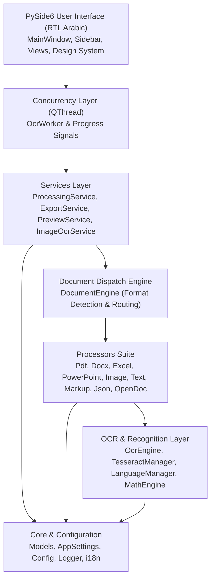

[العربية](README.ar.md) | **English**

---

<div align="center">


# NASS | نَصّ
### Smart Document Text Extraction & Local OCR Desktop Application
**«حيث تتحول الصور إلى كلمات.»** *(Where images become words.)*

[](LICENSE)
[](https://www.python.org/)
[-0A1931.svg)](https://www.qt.io/)
[](https://github.com/tesseract-ocr/tesseract)
[](tests/)
[](docs/ARCHITECTURE.md)

[**العربية (Arabic README)**](README.ar.md) • [**Architecture**](docs/ARCHITECTURE.md) • [**Supported Formats**](docs/SUPPORTED_FORMATS.md) • [**Installation Guide**](docs/INSTALLATION.md) • [**Contributing**](CONTRIBUTING.md)

</div>

---

## 1. Overview

**NASS (نَصّ)** is a modern, production-ready desktop application engineered for high-precision document text extraction and Optical Character Recognition (OCR). Built using Python 3.12, PySide6 (Qt 6), and Tesseract OCR, NASS combines a native Right-to-Left (RTL) Arabic user interface with a robust, modular backend.

NASS is guided by two foundational design principles:
1. **100% Local & Offline Privacy:** All document parsing, image rendering, and OCR runs entirely on your local machine. No document bytes, credentials, or telemetry ever leave your device.
2. **Native Digital Text Priority:** For electronic documents (PDF, Word, Excel, PowerPoint, OpenDocument), NASS extracts crisp digital characters directly first. Scanned documents and embedded images are selectively routed to Tesseract OCR and image filters.

---

## 2. Key Features

- **Broad File Format Support:**
  - **Images:** High-precision OCR for PNG, JPG, JPEG, WEBP, BMP, and multi-page TIFF.
  - **PDF Documents:** Intelligent hybrid extraction (instant digital text extraction, automatic rasterization of scanned pages, and per-page image OCR).
  - **Microsoft Office:** Native text and table extraction for Word (`.docx`), Excel spreadsheets (`.xlsx`, `.xls`, `.csv`), and PowerPoint presentations (`.pptx`).
  - **Plain Text & Markdown:** Encoding auto-detection (UTF-8, Windows CP-1256, Latin-1) for `.txt`, `.md`, and `.rtf`.
  - **Web & Markup:** Semantic extraction from `.html`, `.htm`, and `.xml`.
  - **Structured Data & OpenDocument:** Formatted key-value hierarchy parsing for `.json`, and native extraction for `.odt`, `.ods`, `.odp`, and `.epub`.
  - **Embedded Office Image OCR:** Deep extraction of embedded images inside Word, Excel, and PowerPoint documents with automatic OCR processing.
- **Batch Folder Processing:**
  - Scan entire directories recursively or shallowly with progress tracking, aggregate statistics, and batch CSV export.
- **Interactive Multi-Page Preview:**
  - Real-time page-by-page visual previews with zoom in/out, fit-to-view, and page navigation controls.
- **LaTeX Mathematical Formula Extraction:**
  - Built-in algebraic pattern detector converting fractions, roots, Greek letters, and summation symbols into clean LaTeX notation (`$$...$$`).
- **Comprehensive OCR Engine & Language Management:**
  - Automatic cross-platform discovery of `tesseract.exe` and `tessdata` paths.
  - In-app catalog to search, install, verify, and remove official language packages (`tessdata_fast`).
  - Multi-language recognition combinations (e.g., Arabic + English `ara+eng`).
- **Image Preprocessing Filters:**
  - Configurable Page Segmentation Modes (PSM 0–13) and OCR Engine Modes (OEM 0–3).
  - High-DPI rasterization, grayscale transformation, contrast enhancement, noise reduction, and deskewing.
- **Flexible Multi-Format Export:**
  - One-click copying to clipboard.
  - Formatted UTF-8 plain text (`.txt`), Right-to-Left Microsoft Word (`.docx`), and compilation-ready LaTeX (`.tex`).
- **Operations History:**
  - Searchable audit log of past extractions with re-scanning, individual item deletion, and clear-history controls.

---

## 3. Supported File Formats

| Category | Extensions | Extraction Strategy | Primary Engine / Processor |
|---|---|---|---|
| **Images** | `.png`, `.jpg`, `.jpeg`, `.webp`, `.bmp`, `.tiff`, `.tif` | Tesseract OCR | Pillow + OpenCV + Tesseract 5.x |
| **PDF Documents** | `.pdf` | Hybrid (Native + Raster OCR) | PyMuPDF (`fitz`) + Tesseract 5.x |
| **Microsoft Word** | `.docx` | Native Text + Embedded Image OCR | `python-docx` + `Pillow` + Tesseract |
| **Microsoft Excel** | `.xlsx`, `.xls`, `.csv` | Native Tabular + Embedded Image OCR | `openpyxl` + `csv` + Tesseract |
| **Microsoft PowerPoint** | `.pptx` | Native Shapes + Embedded Image OCR | `python-pptx` + Tesseract |
| **Plain Text & Markdown** | `.txt`, `.md`, `.rtf` | Native Digital Reader | Standard Library (`codecs`, `pathlib`) |
| **Web & Markup** | `.html`, `.htm`, `.xml` | Semantic Parser | `html.parser` + `xml.etree` |
| **Structured Data** | `.json` | Key-Value Hierarchy Parser | Standard Library `json` |
| **OpenDocument & eBooks** | `.odt`, `.ods`, `.odp`, `.epub` | Archive XML Extractor | `zipfile` + `xml.etree` |

For full architectural details, consult [SUPPORTED_FORMATS.md](docs/SUPPORTED_FORMATS.md).

---

## 4. Architecture & Design

NASS follows a layered, decoupled architecture with background thread concurrency:



---

## 5. Requirements

- **Operating System:** Windows 10/11, Ubuntu 22.04+ / Debian 12+, or macOS 12+
- **Python:** Version 3.11 or 3.12 (Python 3.12 recommended)
- **Tesseract OCR:** Version 5.0+ installed locally

---

## 6. Installation & Setup

### 1. Clone Repository
```bash
git clone https://github.com/IbrahimSalha25/NASS.git
cd NASS
```

### 2. Create and Activate Virtual Environment
```bash
# Windows
python -m venv .venv
.\.venv\Scripts\activate

# Linux / macOS
python3 -m venv .venv
source .venv/bin/activate
```

### 3. Install Dependencies
```bash
pip install --upgrade pip
pip install -r requirements.txt
```

### 4. Tesseract OCR Engine Setup

- **Windows:**
  Download the official installer from [UB-Mannheim Tesseract OCR](https://github.com/UB-Mannheim/tesseract/wiki). Ensure "Arabic script" is selected under additional language components during setup.
- **Linux (Ubuntu/Debian):**
  ```bash
  sudo apt update
  sudo apt install tesseract-ocr tesseract-ocr-ara tesseract-ocr-eng
  ```
- **macOS (Homebrew):**
  ```bash
  brew install tesseract tesseract-lang
  ```

---

## 7. Running the Application

Launch the desktop interface:
```bash
python main.py
```

Or using module execution:
```bash
python -m nass.main
```

---

## 8. Running Automated Tests

NASS includes an automated test suite with 86 unit and integration test cases covering all extractors, processors, UI components, and edge cases:

```bash
pytest
```

---

## 9. Project Directory Structure

```text
NASS/
├── assets/
│   ├── icons/                 # Pre-rendered vector UI icons
│   └── images/
│       └── logo_NASS.png      # Official application logo
├── docs/
│   ├── ARCHITECTURE.md        # Technical architecture specification
│   ├── CONTRIBUTING.md        # Contribution guidelines summary
│   ├── INSTALLATION.md        # Detailed cross-platform setup guide
│   └── SUPPORTED_FORMATS.md   # Format matrix and extraction strategies
├── src/
│   └── nass/
│       ├── core/              # Config, domain models, settings, i18n
│       ├── engines/           # Document engine & OCR engine managers
│       ├── processors/        # Format-specific extractors (PDF, Office, etc.)
│       ├── services/          # Processing, export, preview, and image OCR services
│       ├── ui/                # PySide6 RTL interface, views, styles, and icons
│       ├── utils/             # Filesystem and logging utilities
│       └── workers/           # Background QThread concurrency workers
├── tests/                     # 86 comprehensive automated test suites
├── CHANGELOG.md               # Version release notes
├── CODE_OF_CONDUCT.md         # Community code of conduct
├── CONTRIBUTING.md            # Contributor guidelines
├── LICENSE                    # MIT License
├── main.py                    # Root execution entrypoint
├── pyproject.toml             # Modern Python package configuration
├── README.md                  # English documentation (default)
├── README.ar.md               # Arabic documentation
├── requirements.txt           # Project dependencies
└── SECURITY.md                # Security policy and vulnerability reporting
```

---

## 10. Contributing

Contributions are welcomed! Please read our [CONTRIBUTING.md](CONTRIBUTING.md) and [CODE_OF_CONDUCT.md](CODE_OF_CONDUCT.md) before opening a pull request.

---

## 11. License

This project is licensed under the **MIT License** — see the [LICENSE](LICENSE) file for details.

---

## 12. Author & Acknowledgments

- **Lead Developer:** Ibrahim Salha
- **Project:** NASS | نَصّ — *Where images become words.*
