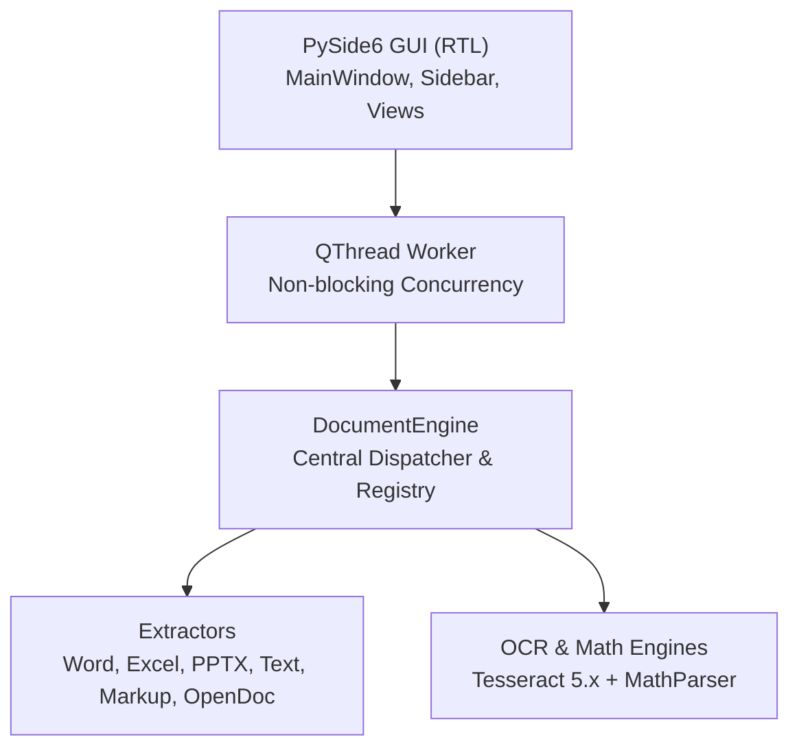

<div align="center">


# نَصّ | NASS
### Smart Document Text Extraction & Local OCR Desktop Application
**«حيث تتحول الصور إلى كلمات.»** *(Where images become words.)*

[](https://opensource.org/licenses/MIT)
[](https://www.python.org/)
[](https://www.qt.io/)
[](https://github.com/tesseract-ocr/tesseract)
[](tests/)
[](docs/ARCHITECTURE.md)

[**العربية (Arabic README)**](README.ar.md) • [**Architecture**](docs/ARCHITECTURE.md) • [**Supported Formats**](docs/SUPPORTED_FORMATS.md) • [**Installation Guide**](docs/INSTALLATION.md) • [**Contributing**](CONTRIBUTING.md)

</div>

---

## 🌟 Overview

**نَصّ (NASS)** is a modern, local-first desktop application designed for high-precision text extraction and optical character recognition (OCR) across a diverse spectrum of document formats. Built with Python 3.12 and PySide6 (Qt for Python), NASS features a clean Right-to-Left (RTL) Arabic user interface, real-time extraction metrics, and advanced pre-processing filters.

NASS adheres strictly to the **Native-First, Offline-Always** philosophy:
- **Zero Data Leakage:** All OCR and extraction runs 100% locally on your machine without third-party APIs or remote telemetry.
- **Native Text Priority:** Automatically extracts lossless embedded digital text from PDF, Word, Excel, and presentations, invoking OCR only when digital text is absent or for scanned images.

---

## ✨ Key Features

- **Multi-Format Document Extraction Suite:**
  - 🖼️ **Images:** High-accuracy OCR for `.png`, `.jpg`, `.jpeg`, `.webp`, `.bmp`, and `.tiff`.
  - 📄 **PDF Documents:** Intelligent hybrid processing (extracts digital vector text first; automatically rasterizes scanned pages for OCR).
  - 📝 **Microsoft Office:** Native text extraction from Word (`.docx`), Excel spreadsheets (`.xlsx`, `.xls`, `.csv`), and PowerPoint presentations (`.pptx`).
  - 📑 **Plain Text & Markdown:** Encoding-aware reading (`.txt`, `.md`, `.rtf`) with RTF control code stripping.
  - 🌐 **Web & Markup:** Semantic extraction from HTML (`.html`, `.htm`) and XML (`.xml`) ignoring scripts and styling.
  - 🗄️ **Structured Data & OpenDocument:** Formatted key-value tree extraction for `.json`, plus native archive extraction for `.odt`, `.ods`, `.odp`, and `.epub`.
- **Integrated Mathematical Formula Recognition (LaTeX):**
  - Built-in algebraic and symbol detector converting fractions, roots, Greek letters, and exponents into standard LaTeX syntax (`$$...$$`).
- **Comprehensive OCR Engine & Language Management:**
  - Automatic detection of Tesseract executable paths on Windows and Unix systems.
  - In-app Language Pack Downloader: browse, search, download, and verify language packages directly from official `tessdata_fast` releases.
  - Full support for multi-language recognition (`ara+eng`).
- **Advanced Pre-processing Filters:**
  - Page Segmentation Mode (PSM) and OCR Engine Mode (OEM) controls.
  - Grayscale conversion, Otsu-style thresholding, contrast enhancement, denoising, and automated deskewing.
- **Multi-Format Results Export:**
  - Plain Text (`.txt`): Clean UTF-8 encoded files with optional page delimiters.
  - Microsoft Word (`.docx`): Formatted Word documents with Right-to-Left paragraph alignment and page dividers.
  - LaTeX (`.tex`): Formatted scientific documents with `amsmath` package support.
- **Modern User Experience:**
  - Unified theme: Deep Navy (`#0F172A`), Royal Blue (`#1E40AF`), and Soft Purple (`#7C3AED`).
  - Friendly Arabic microcopy across all processing stages.
  - Right-docked navigation sidebar with persistent active states.

---

## 📂 Supported Formats Summary

| Category | Extensions | Extraction Method |
|---|---|---|
| **Images** | `.png`, `.jpg`, `.jpeg`, `.webp`, `.bmp`, `.tiff` | Local OCR (Tesseract + Preprocessing) |
| **PDF** | `.pdf` | Hybrid (Native Text First, OCR Fallback) |
| **Word** | `.docx` | Native Document Parsing |
| **Excel & Data** | `.xlsx`, `.xls`, `.csv` | Native Multi-Sheet Tabular Parsing |
| **PowerPoint** | `.pptx` | Native Presentation & Slide Parsing |
| **Plain Text** | `.txt`, `.md`, `.rtf` | Native Text (Multi-Encoding Auto-Detect) |
| **Web & Markup** | `.html`, `.htm`, `.xml` | Native Markup Parsing (Strips Scripts/Styles) |
| **JSON** | `.json` | Native Structured Tree Extraction |
| **OpenDocument & eBooks** | `.odt`, `.ods`, `.odp`, `.epub` | Native Archive & Chapter Parsing |

*See [docs/SUPPORTED_FORMATS.md](docs/SUPPORTED_FORMATS.md) for technical specifications.*

---

## 🚀 Quick Start

### 1. Prerequisites
- Python 3.11+
- Tesseract OCR 5.x ([UB-Mannheim Windows Installer](https://github.com/UB-Mannheim/tesseract/wiki))

### 2. Installation
```bash
# Clone the repository
git clone https://github.com/IbrahimSalha25/NASS.git
cd NASS

# Create and activate virtual environment
python -m venv .venv
.\.venv\Scripts\activate   # On Windows
# source .venv/bin/activate  # On Linux / macOS

# Install dependencies
pip install -r requirements.txt
```

### 3. Launch Application
```bash
python main.py
```

*For comprehensive platform guides, see [docs/INSTALLATION.md](docs/INSTALLATION.md).*

---

## 🧪 Testing

NASS includes a comprehensive automated test suite covering all extractors, OCR integration scenarios, language management, settings persistence, and GUI sanity:

```bash
pytest tests
```
*Current test suite status: **55 passed in ~12 seconds**.*

---

## 🏛️ System Architecture



*For in-depth architectural diagrams and class structures, consult [docs/ARCHITECTURE.md](docs/ARCHITECTURE.md).*

---

## 👨‍💻 Developer & Attribution

**نَصّ | NASS** is designed and developed by:

- **Ibrahim Salha (إبراهيم صالحة)**
- Intelligent Systems & Computer Engineering Student
- Passionate about Artificial Intelligence, Computer Vision, Software Architecture, and open-source software empowering Arabic users.
- **GitHub:** [@IbrahimSalha25](https://github.com/IbrahimSalha25)
- **Email:** [ibrahim.salha19@gmail.com](mailto:ibrahim.salha19@gmail.com)

---

## 📄 License

This project is open-source software licensed under the **[MIT License](LICENSE)**.
Copyright © 2026 Ibrahim Salha. All rights reserved.
