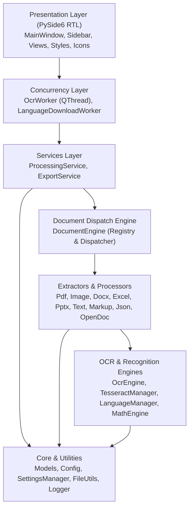
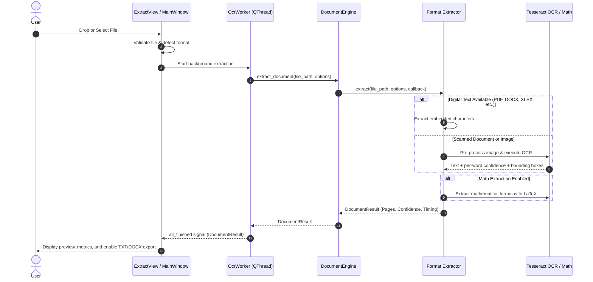

# NASS Architecture Documentation

## 1. System Overview

**نَصّ | NASS** is a local-first, smart document text extraction and Optical Character Recognition (OCR) desktop application written in Python using **PySide6** and **Tesseract OCR**.

### Official Slogan
> **«حيث تتحول الصور إلى كلمات.»** *(Where images become words.)*

### Core Architectural Principles
1. **Local & Offline First:** 100% of processing occurs locally on the user's machine. Zero documents or image pixels leave the system.
2. **Native Text First:** Always extract native digital text first when present (in PDFs, Word documents, Excel spreadsheets, presentations, and markup). Fall back to OCR only when digital text is absent or for image-only files.
3. **Decoupled Architecture:** Strict separation between the Graphical User Interface (GUI), document processing extractors, OCR engines, background concurrency workers, and export services.
4. **Non-blocking UI:** All extraction and OCR tasks execute on background `QThread` workers with fine-grained progress updates and responsive cancellation.
5. **English Codebase & Arabic Interface:** All technical artifacts (code, classes, functions, docstrings, comments, log messages, and errors) are written strictly in English, while the application GUI provides a first-class Right-to-Left (RTL) Arabic user experience.

---

## 2. Layered Architecture



---

## 3. Package Structure

```
src/nass/
├── core/                        # System configurations, models, settings, exceptions
│   ├── config.py                # Paths, constants, extensions, executable discovery
│   ├── exceptions.py            # Hierarchical domain exception classes
│   ├── models.py                # Data classes: DocumentResult, PageResult, OcrOptions
│   └── settings.py              # Persistent user preferences & engine options
├── engines/                     # Recognition and extraction engines
│   ├── base.py                  # Abstract base extractor interface (BaseExtractor)
│   ├── document/                # Central registry and dispatch engine
│   │   └── document_engine.py   # DocumentEngine singleton & dispatcher
│   └── ocr/                     # Optical Character Recognition components
│       ├── language_manager.py  # Language catalog & background installer
│       ├── math_engine.py       # LaTeX formula extractor (Built-in + pix2tex)
│       ├── ocr_engine.py        # Tesseract engine wrapper with filters
│       └── tesseract_manager.py # Executable verification & system discovery
├── processors/                  # Format-specific document processors
│   ├── docx_processor.py        # Microsoft Word (.docx) native extractor
│   ├── excel_processor.py       # Microsoft Excel (.xlsx, .xls) & CSV extractor
│   ├── image_processor.py       # Image OCR processor with Pillow & pre-filters
│   ├── json_processor.py        # Structured JSON text extractor
│   ├── markup_processor.py      # HTML and XML semantic parser
│   ├── opendoc_processor.py     # OpenDocument (.odt, .ods, .odp) & EPUB extractor
│   ├── pdf_processor.py         # Hybrid PDF engine (native text + OCR fallback)
│   ├── powerpoint_processor.py  # Microsoft PowerPoint (.pptx) extractor
│   └── text_processor.py        # Plain text, Markdown (.md), and RTF extractor
├── services/                    # Business workflows and export pipeline
│   ├── export_service.py        # Exporter to TXT (UTF-8), DOCX (RTL), and LaTeX
│   └── processing_service.py    # Document processing coordinator
├── ui/                          # PySide6 desktop interface
│   ├── components/              # Reusable UI widgets (Sidebar, headers)
│   ├── views/                   # Views: Home, Extract, History, OCR Settings, App Settings, About
│   ├── icons.py                 # Clean vector icons (SVG paths)
│   ├── styles.py                # Deep Navy + Royal Blue + Purple QSS theme
│   └── main_window.py           # Host window with right-docked sidebar & QStackedWidget
├── utils/                       # Shared utility helpers
│   ├── file_utils.py            # File validation, MIME detection, size formatting
│   └── logger.py                # Structured console & file logging
└── main.py                      # Application bootstrap entry point
```

---

## 4. Extraction & Processing Pipeline



---

## 5. Technology Stack & Dependencies

| Category | Technology | Purpose |
|---|---|---|
| **Language** | Python 3.11+ | Core implementation with strict type hinting |
| **GUI Framework** | PySide6 (Qt 6.8+) | Desktop application interface with full RTL layout |
| **OCR Engine** | Tesseract OCR (5.x) | Local optical character recognition engine |
| **Python OCR Wrapper** | pytesseract | Native Python bindings for Tesseract executable |
| **PDF Processing** | PyMuPDF (fitz) | Fast PDF text and rasterized image extraction |
| **Word Processing** | python-docx | Native extraction and formatted RTL DOCX export |
| **Excel Processing** | openpyxl | Native multi-sheet cell and tabular extraction |
| **Presentation Processing** | python-pptx | Native slide and shape text extraction |
| **Image Processing** | Pillow (PIL) | Digital image filters, contrast, grayscale, and deskew |
| **Testing** | pytest (9.x) | Automated test suite (55 unit and integration tests) |
