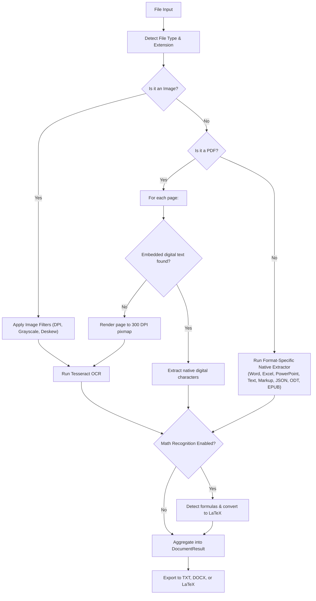

# Supported Formats & Extraction Strategies

**نَصّ | NASS** provides comprehensive text extraction across a wide spectrum of file formats using an intelligent dual-engine architecture:
- **Native Extraction:** Fast, lossless digital extraction for electronic documents.
- **Optical Character Recognition (OCR):** High-precision local OCR via Tesseract for scanned documents and images.
- **Hybrid Extraction:** Intelligently combines both strategies on a per-page basis (ideal for mixed PDFs).

---

## Format Matrix

| Category | File Extension | Extraction Strategy | Primary Engine / Library | Features & Capabilities |
|---|---|---|---|---|
| **Images** | `.png`, `.jpg`, `.jpeg`, `.webp`, `.bmp`, `.tiff`, `.tif` | OCR | Tesseract OCR + Pillow | Preprocessing filters (Grayscale, Thresholding, Denoise, Contrast, Deskew). Multi-language support (`ara+eng`). |
| **PDF Documents** | `.pdf` | Hybrid (Native + OCR Fallback) | PyMuPDF (fitz) + Tesseract | Extracts digital vector text when available. Automatically rasterizes scanned pages to high-DPI images for OCR. |
| **Microsoft Word** | `.docx` | Native Text Extraction | `python-docx` | Headings, paragraphs, bullet points, and multi-column tables. |
| **Microsoft Excel & Data** | `.xlsx`, `.xls`, `.csv` | Native Text Extraction | `openpyxl` + `csv` | Multi-worksheet extraction, preserving row/column relationships and cell data. |
| **Microsoft PowerPoint** | `.pptx` | Native Text Extraction | `python-pptx` | Slide titles, text boxes, shapes, and presenter notes. |
| **Plain Text & Markdown** | `.txt`, `.md`, `.rtf` | Native Text Extraction | Standard Library | Multi-encoding auto-detection (UTF-8, CP1256 Arabic, Latin-1), RTF control code stripping. |
| **Web & Markup** | `.html`, `.htm`, `.xml` | Native Text Extraction | `html.parser` + `xml.etree` | Strips script/style tags, preserves paragraph and list boundaries, extracts XML hierarchy. |
| **Structured Data** | `.json` | Native Text Extraction | `json` | Formatted key-value hierarchy with nested object and array representation. |
| **OpenDocument & eBooks** | `.odt`, `.ods`, `.odp`, `.epub` | Native Text Extraction | `zipfile` + `xml.etree` | Reads `content.xml` directly from ODT/ODS/ODP archives and parses XHTML chapters from EPUB packages. |

---

## Strategy Selection Logic

---

## Export Capabilities

Extracted texts can be exported into multiple formats:
- **Plain Text (`.txt`):** Pure UTF-8 encoding with optional page delimiters and metadata headers.
- **Microsoft Word (`.docx`):** Beautifully styled Word document with Right-to-Left (RTL) paragraph direction, page title callouts, and clean typography.
- **LaTeX Document (`.tex`):** Standard LaTeX document ready for compilation with `amsmath` package for extracted equations.
